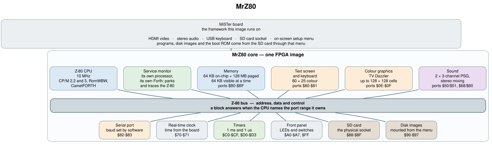

# MrZ80 architecture

## The whole machine in one picture



The Z-80 and everything it talks to hang off one common bus. A block answers to
an I/O port range: the CPU puts the port number on the address bus with `IORQ`
active, and whichever block owns that range drives the data bus. That is why the
port numbers are printed on the blocks — they are the only coordinates most work
needs.

**What each block is**

| Block | Ports | What it does |
|-------|-------|--------------|
| Z-80 CPU | — | The processor, 10 MHz. Runs CP/M 2.2 and 3 under RomWBW, and the CamelFORTH port. |
| Service monitor | — | A second, independent processor inside the same FPGA image, with its own Forth monitor. It can stop the Z-80 at an instruction boundary, single-step it, and read and write its memory while it is stopped. |
| Memory | `$B0-$BF` | 64 KB of on-chip RAM plus 128 MB of board SDRAM. The CPU sees 64 KB at a time as four 16 KB frames, each mapped to any page of the big space; `$B0-$BF` sets the mapping and also gives a direct window onto any physical byte. |
| Text screen and keyboard | `$80-$81` | 80 × 25 colour text on HDMI, with the USB keyboard as its input. |
| Sound | `$50/$51`, `$68/$60` | Two 3-channel PSGs (six channels total) mixed to stereo. Each pair of ports is select/data for one chip. |
| Serial port | `$82-$83` | Console serial, baud set by software. |
| Real-time clock | `$70-$71` | Clock and calendar; the time of day comes from the MiSTer board. |
| Timers | `$C0-$CF`, `$D0-$D3` | Free-running counters at 1 ms and 1 µs, plus the programmable interrupt timer RomWBW uses as its system tick. |
| Front panel | `$A0-$A7`, `$FF` | LED panel: colour and layout RAM for a strip of addressable LEDs, with CPU state captured live. |
| SD card | `$88-$8F` | The physical SD card socket, addressed directly. |
| Disk images | `$90-$97` | The same register layout, but the transfer is done by the MiSTer board on an image mounted from the on-screen menu. |

The MiSTer board itself is not part of the FPGA image — it is the framework every
MiSTer core shares, and it is where the SD card, keyboard, video, audio and
on-screen menu actually live. Boot code, disk images and the monitor firmware all
arrive through that menu.

**Memory**, in short: four 16 KB frames, each pointing at any 16 KB page of a
128 MB space. Page 0 is where a loaded boot image lands, and the 64 KB of
on-chip RAM sits at `0x0800_0000`. RAM disks mounted from the menu are placed at
the top of the SDRAM, out of the way of program memory.

## Reference tables

The port map, as the FPGA decodes it. A device answers only when the whole
window matches and `IORQ` is active; anything else reads `$FF`.

| Ports | Device | Notes |
|-------|--------|-------|
| `$50`, `$51` | PSG 1 select / data | the mapping RomWBW calls `AYMODE_COLECO`; both ports read back the selected register |
| `$60`, `$68` | PSG 2 data / select | the second chip, so dual-PSG players work |
| `$70`, `$71` | real-time clock index / data | |
| `$80`, `$81` | screen data / status-control | |
| `$82`, `$83` | serial data / status-control | |
| `$88`–`$8F` | SD card | raw card access |
| `$90`–`$97` | disk image drive | mounted images |
| `$A0`–`$A7` | front panel | |
| `$B0`–`$BF` | memory management | page mapping, direct physical window |
| `$C0`–`$CF` | free-running counters | |
| `$D0`–`$D3` | interval timer | interrupting |
| `$FF` | front-panel latch | 8 bits of CPU state |

Files loaded from the on-screen menu:

| File | Where it goes |
|------|---------------|
| `.BIN` boot ROM | the bottom of memory (on-chip RAM, if *Boot Load Target* says so) |
| `.DSK` disk images | a RAM-disk slot near the top of the 128 MB |
| `.FPP` front-panel profiles | the panel's own RAM |
| `.MRZ` monitor firmware | the service monitor's memory; the Z-80 keeps running |

On-screen options that change machine behaviour: *Reset* (restarts the loaded
image), *Boot Load Target*, *Flow Control* (serial handshake), *Front Panel
Profile*, *SSP Monitor* and its friends (the service monitor), and *PSG Stereo*
(Mono / ABC / ACB channel panning).

`HARDWARE.md` remains authoritative for bit-level detail on every port, the boot
and reset rules, and the two custom Z-80 instructions this core adds.

## Deeper sheets

Only if you want the implementation. Each is one page, and the text of every
fact they show is in `HARDWARE.md` and the source.

| Sheet | Contents |
|-------|----------|
| [overview](architecture/overview.svg) | the whole core at module level, with the MiSTer framework as one box |
| [z80](architecture/z80.svg) | the CPU complex: bus arbitration between the two masters, the reset-vector trampoline, the MMU, block RAM, the SDRAM client, how wait states are built |
| [peripherals](architecture/peripherals.svg) | each I/O device and what it reaches off-core |
| [iomap](architecture/iomap.svg) | the port map plus the register windows inside the memory controller, panel and sound chip |
| [psg](architecture/psg.svg) | the sound wrapper around the vendored cores: port steering, the mute-and-pan sequencer |
| [ssp](architecture/ssp.svg) | the service monitor: its processor, memory map, and the seam to the Z-80 |
| [clocks](architecture/clocks.svg) | clock domains, the reset tree, and every crossing between domains |

## Regenerating the images

Sources are the `.dot` files beside this document (Graphviz); the rendered SVGs
are committed so the docs read without a toolchain, PNGs are build output:

```sh
make -C doc/architecture      # needs graphviz (dot)
```

Change the `.dot` source, never the rendered image.

## Related documents

- [`HARDWARE.md`](../HARDWARE.md) — memory map, bit-level port detail, boot and reset behaviour, custom instructions.
- [`doc/OVERVIEW.md`](OVERVIEW.md) — narrative tour of the machine, its Forth and the service monitor.
- [`doc/SSP_DESIGN.md`](SSP_DESIGN.md), [`doc/SSP_STATUS.md`](SSP_STATUS.md), [`doc/SSP_REGS.md`](SSP_REGS.md) — service monitor decisions, status, register map.
- [`Components/FRONTPANEL/README.md`](../Components/FRONTPANEL/README.md) — panel datasheet and profile format.
- [`REQUIREMENTS.md`](../REQUIREMENTS.md), [`HISTORY.md`](../HISTORY.md) — what was asked for, and why it ended up this way.
